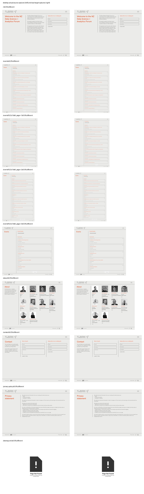
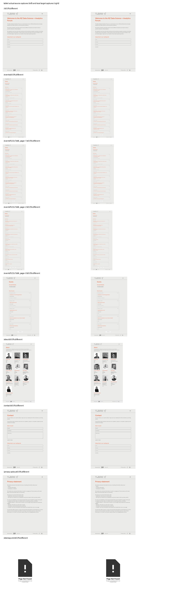
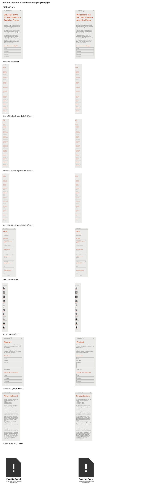

# Matched visual verification

Source: https://analytics.org.nz

Target: `http://127.0.0.1:8000/analytics-org-nz`

Browser: Chromium 154.0.8037.57; device scale factor 1; locale en-US; UTC.

Finished: 2026-10-16T22:58:33.058054+00:00

**66/66 comparisons have identical pixels.** Network errors: 0; browser JavaScript errors: 0.

These are full-page screenshots from actual browser visits. Pixel equality applies to the tested stable states and viewports only. Local target verification does not establish deployed GitHub Pages behaviour.

| Viewport | Dimensions | Route | State | Source capture | Target capture | Difference |
| --- | --- | --- | --- | --- | --- | --- |
| desktop | 1440 × 1000 | `/` | default | [source](local/desktop-home-default-source.png) | [target](local/desktop-home-default-target.png) | Identical |
| desktop | 1440 × 1000 | `/` | menu-open | [source](local/desktop-home-menu-open-source.png) | [target](local/desktop-home-menu-open-target.png) | Identical |
| desktop | 1440 × 1000 | `/` | form-focus | [source](local/desktop-home-form-focus-source.png) | [target](local/desktop-home-form-focus-target.png) | Identical |
| desktop | 1440 × 1000 | `/events` | default | [source](local/desktop-events-default-source.png) | [target](local/desktop-events-default-target.png) | Identical |
| desktop | 1440 × 1000 | `/events` | menu-open | [source](local/desktop-events-menu-open-source.png) | [target](local/desktop-events-menu-open-target.png) | Identical |
| desktop | 1440 × 1000 | `/events` | event-hover | [source](local/desktop-events-event-hover-source.png) | [target](local/desktop-events-event-hover-target.png) | Identical |
| desktop | 1440 × 1000 | `/events?522c7db6_page=1` | default | [source](local/desktop-events-page-1-default-source.png) | [target](local/desktop-events-page-1-default-target.png) | Identical |
| desktop | 1440 × 1000 | `/events?522c7db6_page=1` | menu-open | [source](local/desktop-events-page-1-menu-open-source.png) | [target](local/desktop-events-page-1-menu-open-target.png) | Identical |
| desktop | 1440 × 1000 | `/events?522c7db6_page=2` | default | [source](local/desktop-events-page-2-default-source.png) | [target](local/desktop-events-page-2-default-target.png) | Identical |
| desktop | 1440 × 1000 | `/events?522c7db6_page=2` | menu-open | [source](local/desktop-events-page-2-menu-open-source.png) | [target](local/desktop-events-page-2-menu-open-target.png) | Identical |
| desktop | 1440 × 1000 | `/events?522c7db6_page=2` | event-hover | [source](local/desktop-events-page-2-event-hover-source.png) | [target](local/desktop-events-page-2-event-hover-target.png) | Identical |
| desktop | 1440 × 1000 | `/events?522c7db6_page=3` | default | [source](local/desktop-events-page-3-default-source.png) | [target](local/desktop-events-page-3-default-target.png) | Identical |
| desktop | 1440 × 1000 | `/events?522c7db6_page=3` | menu-open | [source](local/desktop-events-page-3-menu-open-source.png) | [target](local/desktop-events-page-3-menu-open-target.png) | Identical |
| desktop | 1440 × 1000 | `/events?522c7db6_page=3` | event-hover | [source](local/desktop-events-page-3-event-hover-source.png) | [target](local/desktop-events-page-3-event-hover-target.png) | Identical |
| desktop | 1440 × 1000 | `/about` | default | [source](local/desktop-about-default-source.png) | [target](local/desktop-about-default-target.png) | Identical |
| desktop | 1440 × 1000 | `/about` | menu-open | [source](local/desktop-about-menu-open-source.png) | [target](local/desktop-about-menu-open-target.png) | Identical |
| desktop | 1440 × 1000 | `/contact` | default | [source](local/desktop-contact-default-source.png) | [target](local/desktop-contact-default-target.png) | Identical |
| desktop | 1440 × 1000 | `/contact` | menu-open | [source](local/desktop-contact-menu-open-source.png) | [target](local/desktop-contact-menu-open-target.png) | Identical |
| desktop | 1440 × 1000 | `/contact` | form-focus | [source](local/desktop-contact-form-focus-source.png) | [target](local/desktop-contact-form-focus-target.png) | Identical |
| desktop | 1440 × 1000 | `/privacy-policy` | default | [source](local/desktop-privacy-policy-default-source.png) | [target](local/desktop-privacy-policy-default-target.png) | Identical |
| desktop | 1440 × 1000 | `/privacy-policy` | menu-open | [source](local/desktop-privacy-policy-menu-open-source.png) | [target](local/desktop-privacy-policy-menu-open-target.png) | Identical |
| desktop | 1440 × 1000 | `/sitemap.xml` | default | [source](local/desktop-404-default-source.png) | [target](local/desktop-404-default-target.png) | Identical |
| tablet | 834 × 1112 | `/` | default | [source](local/tablet-home-default-source.png) | [target](local/tablet-home-default-target.png) | Identical |
| tablet | 834 × 1112 | `/` | menu-open | [source](local/tablet-home-menu-open-source.png) | [target](local/tablet-home-menu-open-target.png) | Identical |
| tablet | 834 × 1112 | `/` | form-focus | [source](local/tablet-home-form-focus-source.png) | [target](local/tablet-home-form-focus-target.png) | Identical |
| tablet | 834 × 1112 | `/events` | default | [source](local/tablet-events-default-source.png) | [target](local/tablet-events-default-target.png) | Identical |
| tablet | 834 × 1112 | `/events` | menu-open | [source](local/tablet-events-menu-open-source.png) | [target](local/tablet-events-menu-open-target.png) | Identical |
| tablet | 834 × 1112 | `/events` | event-hover | [source](local/tablet-events-event-hover-source.png) | [target](local/tablet-events-event-hover-target.png) | Identical |
| tablet | 834 × 1112 | `/events?522c7db6_page=1` | default | [source](local/tablet-events-page-1-default-source.png) | [target](local/tablet-events-page-1-default-target.png) | Identical |
| tablet | 834 × 1112 | `/events?522c7db6_page=1` | menu-open | [source](local/tablet-events-page-1-menu-open-source.png) | [target](local/tablet-events-page-1-menu-open-target.png) | Identical |
| tablet | 834 × 1112 | `/events?522c7db6_page=2` | default | [source](local/tablet-events-page-2-default-source.png) | [target](local/tablet-events-page-2-default-target.png) | Identical |
| tablet | 834 × 1112 | `/events?522c7db6_page=2` | menu-open | [source](local/tablet-events-page-2-menu-open-source.png) | [target](local/tablet-events-page-2-menu-open-target.png) | Identical |
| tablet | 834 × 1112 | `/events?522c7db6_page=2` | event-hover | [source](local/tablet-events-page-2-event-hover-source.png) | [target](local/tablet-events-page-2-event-hover-target.png) | Identical |
| tablet | 834 × 1112 | `/events?522c7db6_page=3` | default | [source](local/tablet-events-page-3-default-source.png) | [target](local/tablet-events-page-3-default-target.png) | Identical |
| tablet | 834 × 1112 | `/events?522c7db6_page=3` | menu-open | [source](local/tablet-events-page-3-menu-open-source.png) | [target](local/tablet-events-page-3-menu-open-target.png) | Identical |
| tablet | 834 × 1112 | `/events?522c7db6_page=3` | event-hover | [source](local/tablet-events-page-3-event-hover-source.png) | [target](local/tablet-events-page-3-event-hover-target.png) | Identical |
| tablet | 834 × 1112 | `/about` | default | [source](local/tablet-about-default-source.png) | [target](local/tablet-about-default-target.png) | Identical |
| tablet | 834 × 1112 | `/about` | menu-open | [source](local/tablet-about-menu-open-source.png) | [target](local/tablet-about-menu-open-target.png) | Identical |
| tablet | 834 × 1112 | `/contact` | default | [source](local/tablet-contact-default-source.png) | [target](local/tablet-contact-default-target.png) | Identical |
| tablet | 834 × 1112 | `/contact` | menu-open | [source](local/tablet-contact-menu-open-source.png) | [target](local/tablet-contact-menu-open-target.png) | Identical |
| tablet | 834 × 1112 | `/contact` | form-focus | [source](local/tablet-contact-form-focus-source.png) | [target](local/tablet-contact-form-focus-target.png) | Identical |
| tablet | 834 × 1112 | `/privacy-policy` | default | [source](local/tablet-privacy-policy-default-source.png) | [target](local/tablet-privacy-policy-default-target.png) | Identical |
| tablet | 834 × 1112 | `/privacy-policy` | menu-open | [source](local/tablet-privacy-policy-menu-open-source.png) | [target](local/tablet-privacy-policy-menu-open-target.png) | Identical |
| tablet | 834 × 1112 | `/sitemap.xml` | default | [source](local/tablet-404-default-source.png) | [target](local/tablet-404-default-target.png) | Identical |
| mobile | 390 × 844 | `/` | default | [source](local/mobile-home-default-source.png) | [target](local/mobile-home-default-target.png) | Identical |
| mobile | 390 × 844 | `/` | menu-open | [source](local/mobile-home-menu-open-source.png) | [target](local/mobile-home-menu-open-target.png) | Identical |
| mobile | 390 × 844 | `/` | form-focus | [source](local/mobile-home-form-focus-source.png) | [target](local/mobile-home-form-focus-target.png) | Identical |
| mobile | 390 × 844 | `/events` | default | [source](local/mobile-events-default-source.png) | [target](local/mobile-events-default-target.png) | Identical |
| mobile | 390 × 844 | `/events` | menu-open | [source](local/mobile-events-menu-open-source.png) | [target](local/mobile-events-menu-open-target.png) | Identical |
| mobile | 390 × 844 | `/events` | event-hover | [source](local/mobile-events-event-hover-source.png) | [target](local/mobile-events-event-hover-target.png) | Identical |
| mobile | 390 × 844 | `/events?522c7db6_page=1` | default | [source](local/mobile-events-page-1-default-source.png) | [target](local/mobile-events-page-1-default-target.png) | Identical |
| mobile | 390 × 844 | `/events?522c7db6_page=1` | menu-open | [source](local/mobile-events-page-1-menu-open-source.png) | [target](local/mobile-events-page-1-menu-open-target.png) | Identical |
| mobile | 390 × 844 | `/events?522c7db6_page=2` | default | [source](local/mobile-events-page-2-default-source.png) | [target](local/mobile-events-page-2-default-target.png) | Identical |
| mobile | 390 × 844 | `/events?522c7db6_page=2` | menu-open | [source](local/mobile-events-page-2-menu-open-source.png) | [target](local/mobile-events-page-2-menu-open-target.png) | Identical |
| mobile | 390 × 844 | `/events?522c7db6_page=2` | event-hover | [source](local/mobile-events-page-2-event-hover-source.png) | [target](local/mobile-events-page-2-event-hover-target.png) | Identical |
| mobile | 390 × 844 | `/events?522c7db6_page=3` | default | [source](local/mobile-events-page-3-default-source.png) | [target](local/mobile-events-page-3-default-target.png) | Identical |
| mobile | 390 × 844 | `/events?522c7db6_page=3` | menu-open | [source](local/mobile-events-page-3-menu-open-source.png) | [target](local/mobile-events-page-3-menu-open-target.png) | Identical |
| mobile | 390 × 844 | `/events?522c7db6_page=3` | event-hover | [source](local/mobile-events-page-3-event-hover-source.png) | [target](local/mobile-events-page-3-event-hover-target.png) | Identical |
| mobile | 390 × 844 | `/about` | default | [source](local/mobile-about-default-source.png) | [target](local/mobile-about-default-target.png) | Identical |
| mobile | 390 × 844 | `/about` | menu-open | [source](local/mobile-about-menu-open-source.png) | [target](local/mobile-about-menu-open-target.png) | Identical |
| mobile | 390 × 844 | `/contact` | default | [source](local/mobile-contact-default-source.png) | [target](local/mobile-contact-default-target.png) | Identical |
| mobile | 390 × 844 | `/contact` | menu-open | [source](local/mobile-contact-menu-open-source.png) | [target](local/mobile-contact-menu-open-target.png) | Identical |
| mobile | 390 × 844 | `/contact` | form-focus | [source](local/mobile-contact-form-focus-source.png) | [target](local/mobile-contact-form-focus-target.png) | Identical |
| mobile | 390 × 844 | `/privacy-policy` | default | [source](local/mobile-privacy-policy-default-source.png) | [target](local/mobile-privacy-policy-default-target.png) | Identical |
| mobile | 390 × 844 | `/privacy-policy` | menu-open | [source](local/mobile-privacy-policy-menu-open-source.png) | [target](local/mobile-privacy-policy-menu-open-target.png) | Identical |
| mobile | 390 × 844 | `/sitemap.xml` | default | [source](local/mobile-404-default-source.png) | [target](local/mobile-404-default-target.png) | Identical |

## Overview sheets

The thumbnails below are fitted previews; full-resolution captures are linked above.

